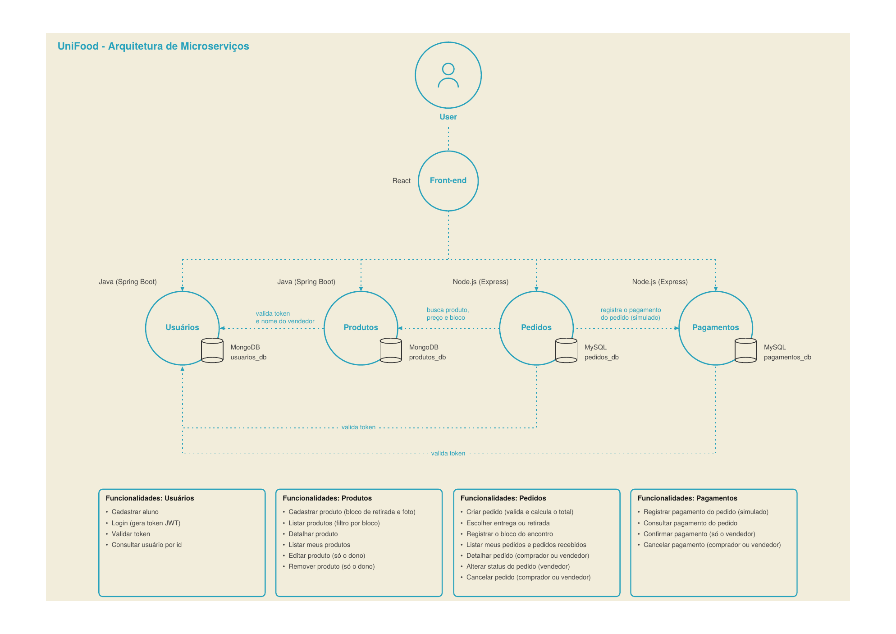

# UniFood

Marketplace de lanches entre alunos do campus: um aluno cadastra produtos com o bloco de retirada,
outro aluno faz o pedido, escolhe entrega ou retirada e registra o pagamento.



- Arquitetura, camadas, SOLID e GRASP: [`docs/arquitetura.md`](docs/arquitetura.md)
- Contrato de rotas entre os serviços: [`docs/API.md`](docs/API.md)

## Estrutura do repositório

```
unifood/
├── servicos/
│   ├── usuarios-service/      Java 17 · Spring Boot · MongoDB (usuarios_db)    — Renan
│   ├── produtos-service/      Java 17 · Spring Boot · MongoDB (produtos_db)    — Renan
│   ├── pedidos-service/       Node.js · Express · MySQL (pedidos_db)           — Ziltom
│   └── pagamentos-service/    Node.js · Express · MySQL (pagamentos_db)        — Ziltom
├── frontend/                  React (Vite) — conecta todos os serviços         — Renan
├── docs/                      arquitetura, contrato de API, diagrama
└── render.yaml                deploy dos serviços no Render
```

## Rodando localmente

Pré-requisitos: Java 17, Maven, Node 18+, MongoDB (local ou Atlas).

```bash
# Usuários (porta 8081)
cd servicos/usuarios-service
MONGODB_URI="mongodb://localhost:27017/usuarios_db" mvn spring-boot:run

# Produtos (porta 8082)
cd servicos/produtos-service
MONGODB_URI="mongodb://localhost:27017/produtos_db" USUARIOS_URL=http://localhost:8081 mvn spring-boot:run

# Pagamentos (porta 3002) — Node.js + MySQL; pagamento simulado, nada é cobrado de verdade
cd servicos/pagamentos-service
cp .env.example .env   # ajuste DATABASE_URL e USUARIOS_URL
npm install && npm run dev

# Pedidos (porta 3001) — Node.js + MySQL; precisa de Usuários e Produtos no ar
cd servicos/pedidos-service
cp .env.example .env   # ajuste DATABASE_URL e as URLs dos serviços
npm install && npm run dev

# Frontend (porta 5173)
cd frontend
cp .env.example .env && npm install && npm run dev
```

Testes: `mvn test` nos serviços Java; `npm test` em `pedidos-service` e `pagamentos-service`.

## Implantação na nuvem

| Parte | Onde |
|---|---|
| Bancos MongoDB | MongoDB Atlas (cluster gratuito) |
| Serviços Java | Render (Docker) via `render.yaml` |
| Frontend | Vercel (pasta `frontend/`), variáveis `VITE_*_URL` apontando para o Render |
